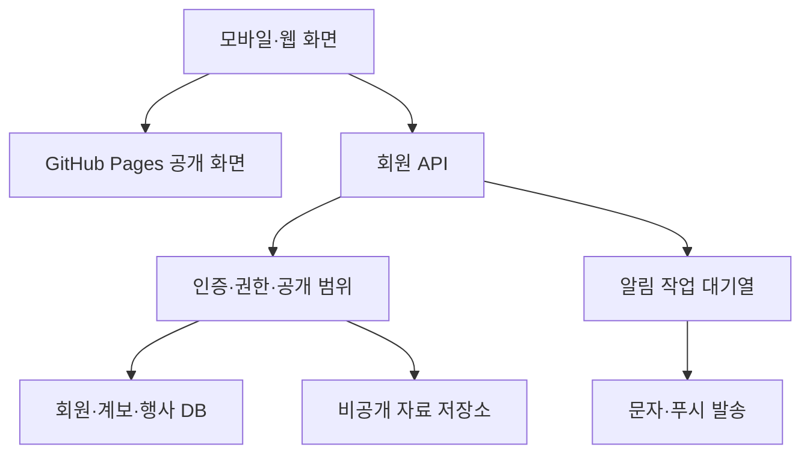

# 실회원 운영을 위한 백엔드 연동 설계

이 문서는 후속 구현 지시입니다. **현재 저장소에는 아래 인증 서버, 데이터베이스, 문자 발송, 운영 권한 검증이 구현되어 있지 않습니다.** 현재의 가상 자료·브라우저 저장을 운영 서비스로 전환할 때 적용합니다.

## 1. 배포 구조

GitHub Pages는 공개 프런트엔드를 계속 담당할 수 있습니다. 회원 정보와 비공개 계보는 별도의 API가 인증·권한을 확인한 뒤 허용되는 항목만 반환합니다. 데이터베이스와 비공개 원본 파일은 정적 빌드에 포함하지 않습니다.

Node.js/TypeScript 또는 Spring Boot처럼 운영자가 유지보수하기 익숙한 서버를 사용하고, 관계 데이터·변경 이력·행사 신청은 트랜잭션을 지원하는 관계형 데이터베이스로 구성합니다. 공급자 선정은 별도이며, 이 설계가 특정 클라우드·SMS 계약이나 계정을 만들어 주지는 않습니다.

## 2. 회원 인증과 종친 승인

휴대전화 번호 소유 확인과 경주김씨 종친임을 확인하는 절차를 분리합니다. 문자 코드를 통과했다고 종친회 회원 권한을 자동 부여하지 않습니다.

| 단계 | 서버 동작 | 결과 |
| --- | --- | --- |
| 번호 확인 | 일회용 인증 코드의 유효시간·실패 횟수·재발송 간격 관리 | 연락 가능한 번호 확인 |
| 가입 신청 | 최소 프로필, 분파·가족 연결 주장, 필요한 동의·약관 버전 접수 | `pending` 상태 |
| 종친 확인 | 지정 관리자 또는 검증 담당자가 근거 확인 | 승인·보완 요청·반려와 이유 기록 |
| 계보 연결 | 계정과 족보 인물의 연결을 별도 심사 | 검증된 `person_id` 연결 |
| 권한 부여 | 역할·조직·분파·행사 범위를 서버에 저장 | 승인 범위만 접근 가능 |
| 변경·탈퇴 | 번호 변경·계보 연결 해제·권한 회수·삭제 요청 처리 | 세션과 공개 범위를 즉시 재검토 |

세션은 서버에서 검증하며 브라우저가 보내는 `role=admin`, 분파 ID, 인물 ID를 신뢰하지 않습니다. 쿠키 세션을 선택하면 HTTPS, HttpOnly·Secure 및 사이트 배치에 맞는 SameSite·CSRF 방어를 함께 설계합니다. 모바일 브라우저 간 인증 호환성도 실제 도메인 구성으로 검증합니다.

## 3. 역할과 범위

아래는 권한 설계의 시작점입니다. 데이터 소유자·종친회가 승인한 공개 정책을 최종 기준으로 사용합니다.

| 역할 | 허용할 작업 | 반드시 제한할 범위 |
| --- | --- | --- |
| 방문자 | 공개 소개·역사·공개 행사 조회 | 회원 디렉터리·비공개 인물 조회 금지 |
| 승인 대기자 | 본인 신청 조회·보완·철회 | 승인 회원 정보 접근 금지 |
| 일반 종친 | 허용된 계보 조회, 행사 신청, 글 작성, 본인 정보 수정 요청 | 개인정보 항목별 공개 범위·본인 소유 확인 |
| 종친회 관리자 | 지정 조직의 가입 심사·역할 위임·공지 운영 | 조직 범위, 관리자 권한 부여 별도 기록 |
| 족보·자료 관리자 | 지정 자료·분파의 수정 심사와 판본 관리 | 연락처 일괄 조회 등 무관 권한 제외 |
| 행사 운영자 | 담당 행사·참석자·현장 체크인 관리 | 다른 행사·전체 회원 명부 접근 제외 |
| 콘텐츠 관리자 | 맡은 게시판·역사 자료 검수 | 계보·회원 승인 권한과 분리 |

목록, 상세, 검색, 첨부파일, 다운로드, 통계 API에 같은 정책을 적용합니다. UI에서 버튼을 숨겨도 API가 열려 있으면 보호되지 않습니다. 검색 자동완성·오류 메시지·총건수도 비공개 인물의 존재를 불필요하게 드러내지 않도록 확인합니다.

## 4. 최소 데이터 모델

| 엔터티 | 핵심 필드·제약 |
| --- | --- |
| `users` | 계정 ID, 인증 수단, 상태, 생성·탈퇴 시각; 비밀 인증정보는 별도 보호 |
| `memberships` | 사용자 ID, 조직 ID, 역할, 허용 범위, 승인자·승인일 |
| `persons` | 안정적인 인물 ID, 이름·별칭, 생존 여부, 출처 상태; 동명이인 자동 병합 금지 |
| `user_person_links` | 계정 ID, 인물 ID, 연결 신청·승인 상태, 검증 근거 |
| `lineage_branches` | 분파 ID, 상위 분파, 기준 인물, 표기·출처 |
| `relationships` | 인물 간 관계 유형, 근거 자료, 검수 상태·유효 구간; 부모·자녀 순환 금지 |
| `generation_labels` | 인물, 기준 인물·판본, 세·대 표기; 기준이 다른 수치를 그대로 비교하지 않음 |
| `sources` | 자료명, 편찬 주체·연도·판본, 권·쪽, 파일 ID, 이용권·확인일 |
| `revisions` | 대상·이전 버전·변경 내용·요청자·승인자·이유·시각 |
| `change_requests` | 변경 제안·근거·검토자·상태·이견·처리 결과 |
| `visibility_rules` | 대상·필드·소유자·허용 역할·조직·가족 범위 |
| `events` | 담당 조직·운영자, 시작·종료·시간대, 신청 마감·정원·상태 |
| `rsvps` | 행사 ID, 회원 ID, 참석 상태·동반 인원·수정일; 행사·회원 유일성 |
| `posts` / `comments` | 작성자, 게시판, 내용, 공개 범위·상태·수정 이력 |
| `notification_jobs` | 대상·동의 범위·템플릿·예약 시각·멱등 키·발송 결과 |
| `audit_events` | 행위자, 작업, 대상 ID, 결과·시각; 내용 전체와 인증정보 기록 금지 |

생존 인물의 연락처·정확한 생년월일 등은 공개 계보의 이름·관계와 분리합니다. 가족이라는 주장만으로 상대방의 연락처 접근을 허용하지 않습니다. 미성년자 정보와 보호자 관리 범위는 운영 정책을 별도로 확정합니다.

## 5. API 계약 예시

아래 경로는 구현 예정 계약이며 현재 호출 가능한 API가 아닙니다.

| API | 동작 | 필수 검사 |
| --- | --- | --- |
| `POST /v1/auth/challenges` | 인증 코드 요청 | 속도 제한, 동일 대상 재전송 제한 |
| `POST /v1/auth/verifications` | 코드 확인·세션 생성 | 만료·시도 횟수·재사용 방지 |
| `POST /v1/membership-applications` | 가입 신청 | 필수 동의·최소 필드·중복 신청 |
| `GET /v1/me` | 계정·승인·허용 기능 조회 | 유효한 세션 |
| `GET /v1/persons` | 권한 범위 내 검색 | 승인 상태, 행·필드 필터, 페이지 크기 제한 |
| `GET /v1/persons/:id/relations` | 제한된 깊이의 계보 조회 | 모든 노드의 공개 범위, 탐색 깊이·개수 제한 |
| `POST /v1/persons/:id/change-requests` | 수정 요청 접수 | 신청 자격, 입력 검증, 근거 자료 접근 |
| `POST /v1/change-requests/:id/decisions` | 승인·반려·보완 결정 | 검토 역할·범위, 현재 버전 일치 |
| `PUT /v1/events/:id/rsvp` | 본인 참석 여부 저장 | 행사 상태·마감·정원, 유일성·멱등성 |
| `GET /v1/events/:id/attendees` | 담당 행사의 참석자 확인 | 행사 운영자 범위, 필요한 필드만 반환 |
| `POST /v1/posts` | 공동 게시글 작성 | 게시판 권한, 길이·첨부 제한, 입력 안전 처리 |
| `POST /v1/account/deletion-requests` | 본인 삭제 요청 | 최근 인증, 처리 대상·유지 근거 확인 |

응답에는 페이지 커서·검토 상태·버전 등을 반환하고, 권한 밖의 필드는 서버에서 제거합니다. 계보·행사 수정은 버전 충돌을 확인하여 다른 관리자의 수정 내용을 덮어쓰지 않도록 합니다.

## 6. 족보 수정·이견 처리

1. 요청자가 대상 인물·관계, 현재 기록, 제안 내용과 근거를 제출합니다.
2. 담당자는 원본 판본·페이지와 중복 인물·모순 관계를 확인합니다.
3. 보완이 필요하거나 관계자 간 이견이 있으면 `needs_evidence` 또는 `disputed`로 표시하고 기존 확정 기록을 유지합니다.
4. 지정 검토자가 승인·반려·병기 여부를 결정하고 이유·근거·검토 시각을 남깁니다.
5. 승인은 하나의 트랜잭션으로 새 버전과 변경 기록을 저장합니다. 승인 전의 제안을 확정 계보로 자동 노출하지 않습니다.
6. 이의 신청과 재검토는 기존 결정의 연결 기록으로 남깁니다. 이전 버전을 지워 이견을 없애지 않습니다.

관계 데이터에 부모·자녀 순환, 자기 자신과의 관계, 동일 관계의 중복이 없는지 검사합니다. 불명확한 생년·날짜를 추정해서 확정 필드에 넣지 않습니다.

## 7. 개인정보·자료 관리

| 상황 | 구현 지시 |
| --- | --- |
| 자료 업로드 | 비공개 저장소에 저장하고 파일 형식·크기 검사, 접근 허용 후 제한 시간 URL 발급 |
| 자료 내려받기 | 다운로드 권한·공개 필드를 별도 검증, 대량 내보내기는 사유·담당자 기록 |
| 데이터베이스·백업 | 관리형 암호화와 키 권한 설정, 복구 시험, 보존 기한 설정 |
| 접근 기록 | 누가 어떤 대상에 어떤 작업을 했는지 기록하고 연락처·본문·인증 코드는 로그에서 제외 |
| 계정 삭제 | 세션·자격 즉시 회수, 프로필·연락처·콘텐츠의 삭제·익명화 정책 실행 |
| 족보 수정·삭제 요청 | 요청자의 정보와 독립된 역사 기록을 구분하여 보존 근거·공개 범위를 검토하고 결과 통지 |
| 백업의 삭제 반영 | 삭제 표식·보존 기한 관리, 복구 시 삭제 대상을 다시 적용 |
| 운영자 변경 | 역할 회수, 관리 계정 다중 인증, 복구 연락처·열쇠 이전 |

보존 의무나 권리 처리 기한을 임의로 단정하지 않습니다. 수집 목적·보존 기간·동의·삭제 절차는 실제 운영 주체와 자료의 성격에 맞춰 확정합니다. 여기의 설계가 법률 검토나 법적 적합성 인증을 대신하지 않습니다.

## 8. 행사·알림 신뢰성

날짜·시간은 데이터베이스에서 명확한 시간대와 함께 보관하고 화면에서는 행사 기준 시간대를 표시합니다. 참석 신청·취소는 한 회원·한 행사 기준으로 멱등하게 처리하고, 정원이 있으면 트랜잭션 안에서 잔여 자리를 확인합니다. 신청 마감은 화면뿐 아니라 서버에서도 적용합니다.

문자·푸시는 동의 상태를 발송 직전 다시 확인합니다. 예약 작업마다 멱등 키를 사용하고, 재시도·중복 방지·실패 상태를 기록합니다. 행사 취소·변경은 기존 예약 알림도 함께 갱신합니다. 운영자는 신청·불참·대기·현장 참석을 서로 다른 상태로 구분합니다.

## 9. 운영 전 확인할 실제 시험

| 시험 | 통과 조건 |
| --- | --- |
| 미승인 접근 | 인물·디렉터리·파일 URL을 직접 호출해도 보호 자료가 반환되지 않음 |
| 역할·범위 위조 | 브라우저 저장값·요청의 역할·조직·회원 ID를 바꿔도 권한 상승 불가 |
| 연락처 공개 범위 | 목록·검색·상세·내보내기 모두 같은 필드 정책 적용 |
| 데이터 충돌 | 동시에 수정·신청해도 기록 유실·중복·정원 초과가 없음 |
| 계보 검증 | 순환·중복·부정확한 연결 요청이 승인 데이터로 들어가지 않음 |
| 삭제·복구 | 삭제·권한 회수 즉시 반영, 백업 복구 후에도 유지 |
| 알림 재시도 | 일시 실패를 재처리해도 중복 발송이 없고 취소된 행사 알림은 중단 |
| 고령 사용자 과업 | 안내자의 대신 조작 없이 공지 확인·참석 등록을 완료 |

현재 데모의 테스트는 이 운영 시험을 대체하지 않습니다. 백엔드 도입 시 가상 데이터로 통과시킨 뒤 권한과 이용 근거가 확인된 최소한의 실자료부터 단계적으로 적용합니다.
